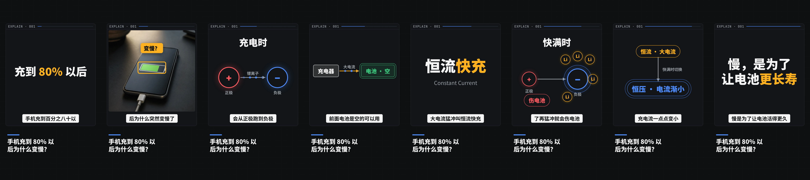

# 示例：手机充到 80% 以后为什么变慢？

第二阶段的演示项目：19 秒竖屏，8 个镜头，用到全部 3 个积木与 2 个转场。成片见 [out/battery-80.mp4](out/battery-80.mp4)。

- **语音**：`voice.json` 是按参考集语速（约 340 字 / 分钟、几乎不停顿）合成的逐字时间轴，**没有音频**。TTS 在第三阶段接入。
- **素材**：`media.image/phone-charging` 由 gpt-image-2 生成，见其清单中的 prompt。
- **复现**：通过 MCP `project_init(name, from_example="battery-80")` → `render_video`，或直接运行 engine 脚本。

## 与参考 profile 的对比（重建测试的简化版）

用第一阶段的测量工具分析成片（`--asr file:voice.json`），与 `analysis/chaping/reference-profile.json` 的 9:16 组对比：

| 指标 | 本片 | 参考 P10 / P50 / P90 | 判断 |
|---|---|---|---|
| 视觉边界 / 分钟 | 21.9 | 19.4 / 21.5 / 23.5 | ✅ |
| 段时长 (s) | 1.8 / 2.1 / 3.2 | 1.0 / 2.4 / 4.4 | ✅ |
| 字幕字高 / H | 0.029 | 0.025 / 0.028 / 0.034 | ✅ |
| 字幕每行字数 | 3 / 6 / 10 | 4 / 9 / 13 | ✅ 略短 |
| 入场时长 (s) | 0 / 0.30 / 0.62 | 0 / 0.43 / 1.2 | ✅ 略快 |
| 直接出现占比 | 20% | 29% | ✅ |
| 画面彩度 C | 0.008 | 0.006 / 0.012 / 0.026 | ✅ |
| **画面亮度 L** | **0.23** | 0.31 / 0.41 / 0.54 | ❌ 偏暗 |
| 硬切 / 分钟 | 6.3 | 7.3 / 8.2 / 12.2 | 规范 v0.1 不设下限 |

**解读**：节奏、字幕、动效都落在参考区间内。亮度偏暗是**内容配比**问题，不是积木问题：参考视频约 46% 是明亮的实拍素材，本片 8 个镜头只有 1 个素材镜头。这类差异正是 profile 应该反馈给 agent 的（第四阶段的评分卡）。

**测量本身的问题**：大字标题的文字与语音一致，被测量工具归为"字幕"，导致字幕中心 y 的分布被拉到画面中部。对自己的成片应改用渲染时导出的元素信息（docs/00 §4.2 `bridge`），而不是 OCR。

## 制作过程中靠看图发现并修掉的问题

| 问题 | 修复位置 | 对应规范 |
|---|---|---|
| 方框节点的连线端点按圆形计算，箭头压字 | `mg-diagram`：按矩形边界求交 | H5 |
| 大字超出宽度，意外折行 | `title-kinetic`：自动缩放 + 不折行 | H4 |
| 话题栏折行后孤字 | `window-frame`：`text-wrap: balance` | H4 |
| 竖直连线的标签压线 | `mg-diagram`：标签放在法线方向 | H5 |
| 方框 / 胶囊的强调光环是圆的 | `mg-diagram`：同形脉冲 | — |
| 大号方框出画 | `mg-diagram`：`geom()` 收进内容区 | H4 |
